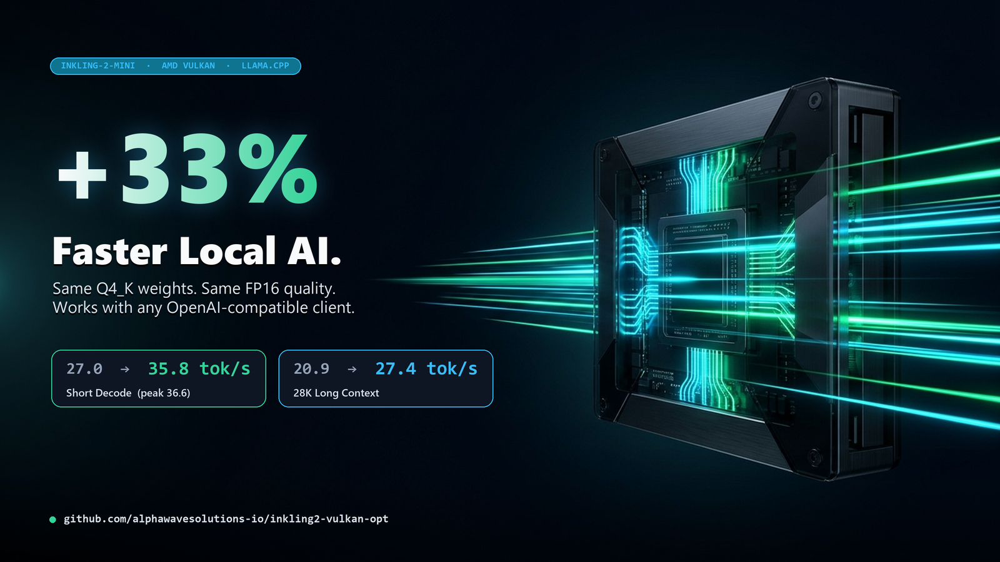
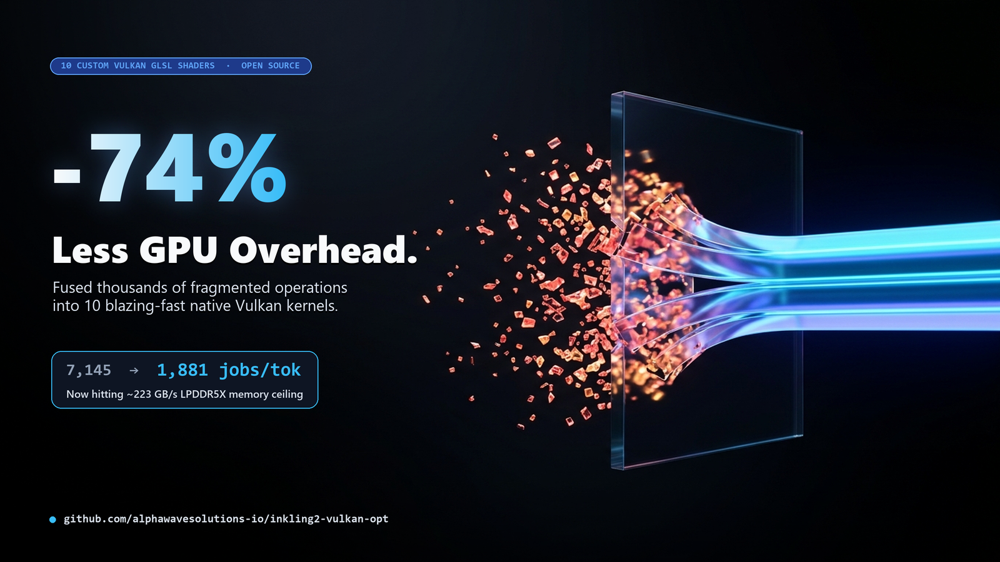
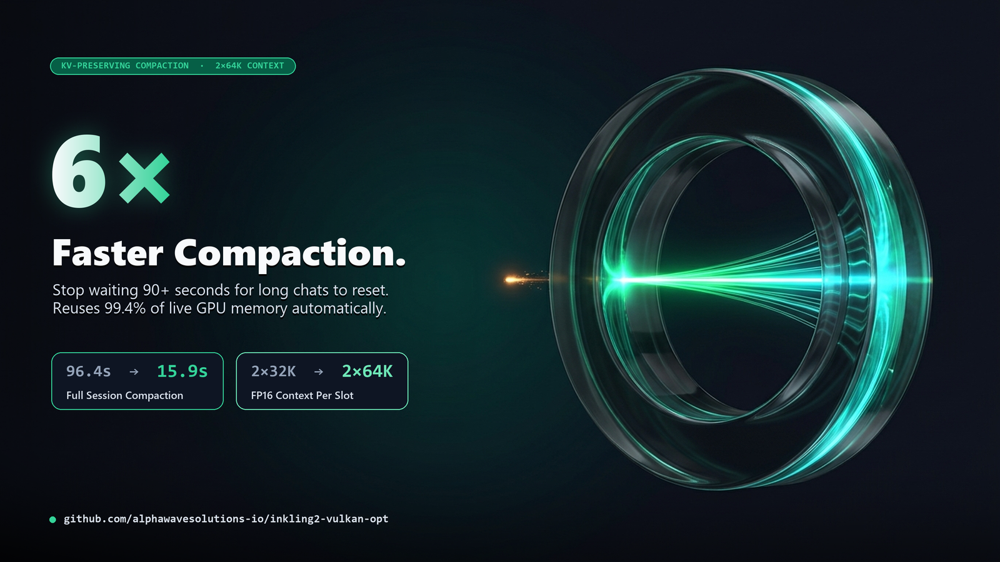

# Inkling-2-Mini Speed & Compaction Optimizations (`llama.cpp` + AMD Vulkan)



Make **Inkling-2-Mini** feel dramatically snappier on AMD Vulkan GPUs (tested on **Ryzen AI Max+ 395 / Radeon 8060S "Strix Halo"**) — **without touching model quality or locking you into any specific app**.

Works with **any OpenAI-compatible client or coding harness** (Open WebUI, Cline, Roo Code, Continue, Aider, Zed, SillyTavern, custom Python/JS scripts, Pi, OpenCode, etc.).

---

## The Improvements at a Glance

| What Improves | Before (Stock `llama.cpp`) | After (This Repo) | What You Feel |
|---|---:|---:|---|
| **Short-chat typing speed** | 27.0 tok/s | **35.8 tok/s** *(peak 36.6)* | **+33% faster** responses |
| **Long 28K-chat typing speed** | 20.9 tok/s | **27.4 tok/s** *(paired 26.3)* | **+26% to +32% faster** in deep coding sessions |
| **Reading long prompts (28K)** | 115 seconds | **100 seconds** | **+16% faster** prompt processing |
| **Session compaction time** | 96.4 seconds | **15.9 seconds** | **6.1× faster** — almost instant reset |
| **Usable context per slot** | 32K *(~18.5K usable)* | **64K** *(~50K usable)* | **~2.7× fewer compactions** |
| **Output accuracy & quality** | Q4_K + FP16 KV | **Exact same Q4_K + FP16 KV** | **Zero quality loss** *(100% bit-exact short outputs)* |

---

## Fastest Setup: Just Point Your Coding Agent at This Repo

You don't have to patch C++ or compile Vulkan shaders by hand. If you use **Claude Code, Codex, Cursor, Antigravity, Cline, OpenCode, Pi**, or any coding agent with terminal access, just paste this prompt:

> **Copy-paste prompt for your coding agent:**
> ```text
> Read https://github.com/alphawavesolutions-io/inkling2-vulkan-opt and apply these
> optimizations to my local Inkling-2-Mini llama.cpp Vulkan setup. Back up my current
> server binary and config files first so I can roll back anytime, build the patched
> llama-server with Vulkan enabled, update my server launch flags to the recommended
> configuration (-b 512 -ub 256, and 2x64K FP16 KV if I have 32GB+ VRAM), and verify
> everything starts cleanly. If my harness supports compaction hooks, apply the
> KV-preserving compaction pattern from compaction/README.md as well.
> ```

---

## What We Actually Did (In Plain English)

### 1. Stopped Making the GPU Do 7,145 Tiny Trips Per Word (`+33% Speed`)



Inkling-2-Mini uses a clever looped architecture with several custom math blocks at every layer. Stock `llama.cpp` didn't have dedicated Vulkan GPU programs ("shaders") for those Inkling-specific pieces — so to generate **one single word (token)**, the CPU was splitting the work into **7,145 tiny separate GPU jobs**, constantly writing temporary results out to memory and reading them right back.

Think of it like driving to the grocery store 7,145 times to buy one grape per trip instead of bringing a basket.

We wrote **10 custom all-in-one Vulkan GPU shaders** that combine those scattered micro-steps into single passes, plus two AMD GPU scheduling fixes:
- GPU jobs per word dropped from **7,145 → 1,881 (-74%)**.
- The GPU now spends **70% of its time** pulling model weights at **190–223 GB/s** — essentially maxing out the laptop's ~229 GB/s memory hardware ceiling.

### 2. Stopped Throwing Away the GPU's Memory During Compaction (`6.1× Faster`)



When a long coding chat gets full and your tool has to summarize ("compact") it, most tools build a brand-new standalone prompt (`"Summarize this transcript: ..."`). Because that prompt doesn't match what's already in GPU memory, `llama-server` throws away its entire cache and spends **~80 seconds** re-reading the conversation from scratch before writing a single word.

Instead, we keep the **exact conversation already sitting in GPU memory** and simply append one short *"summarize the conversation above"* message at the end:
- **99.4% of the GPU's KV cache is reused** (`20,985 / 21,121` tokens).
- Reading time drops from **79.0 seconds → 0.9 seconds (87× faster)**, cutting total compaction from **96.4 s → 15.9 s**.
- We also bumped the server from **2×32K → 2×64K** slots. Because only 8 of Inkling's 48 layers need full long-range memory (the other 40 use small sliding windows), doubling context only adds ~2 GB of VRAM — fitting comfortably in **23.1 GB** on a 32 GB GPU heap and cutting how often you compact by **~2.7×**.

### 3. Two Surprising "Gotchas" We Fixed Along the Way

1. **Don't bump `--ubatch-size` to `1024`**: Larger batch sizes usually speed up prompt reading, but on Inkling-2-Mini `-ub 1024` overflows Vulkan's 4 GB single-buffer limit, spills **6.6 GB** into slower host RAM, and actually makes prompt reading **35% slower** (`281 → 182 tok/s`). Stick with **`-b 512 -ub 256`**.
2. **Don't change `reasoning_effort` mid-session (and always cap thinking during compaction)**: Inkling inserts `"Thinking effort level: 0.2"` near the very start of the conversation. Switching it to `"none"` during compaction invalidates 99% of your KV cache — while setting `reasoning_budget_tokens: 0` triggers an empty-thought loop, and omitting a budget lets Inkling ramble for 1,600+ thinking tokens. Keeping `reasoning_effort` untouched + setting `tool_choice: "none"` + `reasoning_budget_tokens: 32` works cleanly every time.

---

## Manual Quick Start (Works With Any Client)

### 1. Apply the Vulkan patches to `llama.cpp` `b12628`

```bash
git clone https://github.com/ggml-org/llama.cpp.git
cd llama.cpp
git checkout b12628   # commit 8a97fa98a
git apply /path/to/patches/inkling2-vulkan-opt-b12628-combined.patch
```

*(Or use `git am /path/to/patches/000*.patch` to keep the 3 separate commits.)*

### 2. Build `llama-server` with Vulkan enabled

On Windows (MSVC + Ninja + Vulkan SDK with `glslc`): see [`scripts/build-vulkan-windows.example.cmd`](scripts/build-vulkan-windows.example.cmd).

```bash
cmake -B build -G Ninja \
  -DCMAKE_BUILD_TYPE=Release \
  -DGGML_VULKAN=ON \
  -DLLAMA_BUILD_TESTS=OFF \
  -DLLAMA_BUILD_EXAMPLES=OFF
cmake --build build --target llama-server --parallel
```

### 3. Launch `llama-server`

```bash
LLAMA_ARG_CHAT_TEMPLATE_KWARGS='{"reasoning_effort":"low"}' \
./build/bin/llama-server \
  --model /path/to/Inkling-2-Mini-Uncensored-AD-Q4_K.gguf \
  --mmproj /path/to/mmproj-Inkling-2-Mini-Uncensored-F16.gguf \
  --no-mmproj-offload \
  --alias inkling-2-mini-uncensored \
  --host 127.0.0.1 --port 18089 \
  --ctx-size 131072 --parallel 2 --no-kv-unified \
  --batch-size 512 --ubatch-size 256 \
  --device Vulkan0 --n-gpu-layers all \
  --jinja --cache-ram 0 \
  -ctk f16 -ctv f16 \
  --spec-type none --sleep-idle-seconds 600 --no-webui
```

*(Have 24 GB VRAM instead of 32 GB+? Use `--ctx-size 65536 --parallel 2` for `2×32K` slots at ~19.5 GB total.)*

### 4. Optional: Add 6× Faster KV-Preserving Compaction

See [`compaction/README.md`](compaction/README.md) for the **universal plain-HTTP JSON recipe** (works from any language or agent loop), the zero-dependency [`checkpoint.mjs`](compaction/checkpoint.mjs) module, and optional reference adapters for Pi and OpenCode.

---

## Repository Layout

```text
.
├── README.md
├── LICENSE
├── assets/                                                            # Visual summary cards
├── patches/
│   ├── inkling2-vulkan-opt-b12628-combined.patch                      # Single combined patch (`git apply`)
│   ├── 0001-Inkling-Vulkan-opt-Wave-A1-A2a-graph-cleanup-Q5_0-MM.patch
│   ├── 0002-Inkling-Vulkan-opt-Wave-A2e-DEPTH_MIX_CUR-BANK-CONTR.patch
│   └── 0003-Inkling-Vulkan-opt-Wave-A3b-reg-cached-512-thread-DE.patch
├── scripts/
│   ├── build-vulkan-windows.example.cmd                               # Windows MSVC + Ninja + Vulkan SDK template
│   └── Start-Inkling-opt-64k.example.ps1                              # Parameterized 2×64K FP16 server launcher
├── compaction/
│   ├── README.md                                                      # Universal HTTP recipe + optional adapter setup
│   ├── checkpoint.mjs                                                 # Zero-dependency vanilla JS compaction engine
│   └── examples/
│       ├── pi/index.ts                                                # Optional Pi extension reference adapter
│       └── opencode/index.js                                          # Optional OpenCode plugin reference adapter
└── benchmarks/
    ├── METHODOLOGY.md                                                 # Hardware, GGUF SHA-256, flags, and repro steps
    ├── summary.json                                                   # Complete structured benchmark & quality data
    └── bench_ab.py                                                    # Parameterized A/B benchmark script
```

---

## Technical Deep Dive & Verified Benchmarks

*Everything below is for developers and hardware enthusiasts who want the exact numbers, profiling methodology, shader details, and reproduction scripts.*

### Test System & Model

- **Hardware**: ASUS ROG Flow Z13 (2025) on AC power · AMD Ryzen AI Max+ 395 · AMD Radeon 8060S (`gfx1151`, RDNA 3.5, 40 CUs, wave64, `KHR_coopmat`) · 64 GB unified LPDDR5X (~229 GB/s practical ceiling, 32,843 MiB Vulkan heap)
- **OS & Base**: Windows 11 x64, AMD proprietary Vulkan driver, Vulkan SDK 1.4.363.1, [`llama.cpp` `b12628`](https://github.com/ggml-org/llama.cpp) (`8a97fa98a`)
- **Model**: `Inkling-2-Mini-Uncensored-AD-Q4_K.gguf` (`inkling2_loop`, 26.07B MoE, 8/128 active experts, 24 physical layers looped to 48 executed layers; SHA-256 `36e99f1f56ca33cb356f19d7e3822938f65af1cde978ad13170238928d4c955f`)

### 1. Paired Alternating A/B: Stock `b12628` vs. Patched Build

Exact identical production flags (`--ctx-size 65536 --parallel 2 --no-kv-unified -b 512 -ub 256 -ctk f16 -ctv f16`, Flash Attention on, full GPU offload, `reasoning_effort=low`), alternating `control → optimized → control → optimized` to neutralize thermal/PPT drift:

| Metric | Stock `b12628` (Baseline) | Optimized (`ea45100`) | Delta vs. Baseline |
|---|---:|---:|---:|
| **Short decode (107 tok, paired A/B median)** | 27.00 tok/s *(37.04 ms/tok)* | **35.84 tok/s** *(27.90 ms/tok; cold peak 36.62)* | **+32.7%** *(-9.14 ms/tok)* |
| **28K long decode (27,998 tok, paired A/B)** | 20.85 tok/s *(47.96 ms/tok)* | **26.26 – 27.44 tok/s** *(36.44–38.08 ms/tok)* | **+25.9% to +31.6%** *(-9.9 to -11.5 ms/tok)* |
| **28K prompt prefill (`-b 512 -ub 256`)** | 242.6 tok/s *(115.4 s)* | **271.5 – 281.0 tok/s** *(99.6–103.1 s)* | **+11.9% to +15.8%** *(-12.3 to -15.8 s)* |
| **Vulkan dispatches / decode token** | 7,145 | **1,881** | **-73.7%** *(-5,264 dispatches/tok)* |
| **GPU kernel time / short token** | 39.89 ms | **26.46 ms** | **-33.7%** *(-13.43 ms/tok)* |
| **Short greedy determinism (6/6 repeats)** | SHA `9d2af481fd1eb5cc` | **SHA `9d2af481fd1eb5cc`** | **100% bit-exact** |

### 2. Wave-by-Wave Engineering Progression

| Stage (Patch) | Dispatches / Tok | GPU Kernel Time | Short Decode (107 tok) | 28K Decode (28K tok) | Key Additions |
|---|---:|---:|---:|---:|---|
| **Baseline** (`b12628`) | 7,145 | 39.89 ms | 27.00–28.56 tok/s | 20.85–21.20 tok/s | Stock Vulkan backend |
| **Wave 1** (`0001`, `ff2bbbf`) | 3,659 *(-48.8%)* | ~31.0 ms | 32.57 tok/s *(peak 33.38)* | — | Graph cleanup, AMD `Q5_0` MMVQ threshold (`k >= 1024`), fused `TOPK_MOE`, `L2_CLIP`, `SITU`, `CONTROL_APPLY`, `REL_BIAS_MASK`, `SSM_CONV_RES_SCALE` |
| **Wave 2** (`0002`, `dd903dd`) | 2,417 *(-66.2%)* | 28.60 ms | 34.10 tok/s *(peak 34.76)* | 25.44 tok/s | `DEPTH_MIX_CUR+BANK`, `CONTROL_DOWN_Q8_0`, `CONTROL_UP_APPLY_Q8_0`, `REL_BIAS_MASK_DIRECT`, `SIGMOID_MUL`, initial `SSM_CONV_DECODE` (25/192) |
| **Wave 3** (`0003`, `ea45100`) | **1,881 *(-73.7%)*** | **26.46 ms** | **35.84–36.13 tok/s *(peak 36.62)*** | **26.26–27.44 tok/s** | Register-cached 512-thread single-barrier `DEPTH_MIX`, coalesced 256-thread `CONTROL_DOWN_Q8_0`, **192/192** `SSM_CONV_DECODE` + `DYN`, AMD RDNA3/4 long-KV FA `split_k = 4` |

### 3. GPU Roofline Breakdown (`GGML_VK_PERF_LOGGER=1`, 107-tok Decode)

| Category | GPU Time / Token | Share of 26.46 ms | Notes |
|---|---:|---:|---|
| **Large matrix multiplies** (`Q4_K` MoE gate/up `5.66 ms`, `Q5_0` MoE down `3.82 ms`, `Q8_0` QKV/O `6.96 ms`, `lm_head` `2.15 ms`) | **18.59 ms** | **70.3%** | Memory-bandwidth bound at **190–223 GB/s** vs. ~229 GB/s LPDDR5X ceiling |
| **10 Custom Fused Inkling Shaders** (`192× SSM_CONV_DECODE+DYN` `0.55 ms`, `120× DEPTH_MIX` `0.85 ms`, `192× CONTROL_DOWN/UP` `1.11 ms`, `48× REL_BIAS_MASK_DIRECT` `0.20 ms`, `144× L2_CLIP` `0.30 ms`, `48× SITU` `0.13 ms`, `48× SIGMOID_MUL` `0.16 ms`, `48× TOPK_MOE` `0.27 ms`) | **3.57 ms** | **13.5%** | Reduced from **>16 ms** across ~5,500 unfused ops |
| **Flash Attention + norms + router + KV writes + small projections** | **4.30 ms** | **16.2%** | Short-context FA is `0.83 ms`; at 28K context, `fa_split_k_mult = 4` (`N == 1 && KV >= 4096`) saves `-0.84 ms/tok` on global layers without touching SWA layers |
| **Total GPU time / token** | **26.46 ms** | **100%** | Uninstrumented wall-clock is **27.3–27.9 ms/tok** (<1 ms CPU dispatch overhead) |

### 4. End-to-End Accuracy & Quality Verification

| Task (`temperature=0`, `reasoning_effort=low`, `max_tokens=1600`) | Context Depth | Decode Speed | Verified Result |
|---|---:|---:|---|
| Python coding (`merge_intervals`, 7-case AST + unit tests) | 107 tokens | **35.62 tok/s** | **7/7 tests PASS** |
| Code review (strict `PASS`/`FAIL` verdict) | 107 tokens | **35.29 tok/s** | **`PASS`** |
| Python coding (`merge_intervals`, 7-case AST + unit tests) | 27,998 tokens | **27.19 tok/s** | **7/7 tests PASS** |
| Code review (strict `PASS`/`FAIL` verdict) | 27,998 tokens | **27.15 tok/s** | **`PASS`** |

### 5. Context Sizing, Batching & VRAM Analytics

| Server Configuration (FP16 KV, 2 Parallel Slots) | Total VRAM | Compute VRAM | Host Spill | 28K Prefill | 28K Decode | Notes |
|---|---:|---:|---:|---:|---:|---|
| `2×32K`, `-b 512 -ub 256` *(stock)* | 19.5 GiB | 1.78 GiB | 84 MiB | **281.0 tok/s** | **27.44 tok/s** | Optimal for 24 GiB systems |
| `2×32K`, `-b 1024 -ub 512` | 21.3 GiB | 3.47 GiB | 169 MiB | 281.0 tok/s | 27.18 tok/s | No speed gain, 2× compute VRAM |
| `2×32K`, `-b 2048 -ub 1024` | 20.2 GiB | 2.19 GiB | **6,581 MiB** | **181.7 tok/s** | 25.20 tok/s | **Regression**: exceeds 4 GiB Vulkan buffer limit |
| **`2×64K`, `-b 512 -ub 256`** *(recommended on 32 GiB+)* | **23.1 GiB** *(+8.1 GiB free)* | **3.32 GiB** | **164 MiB** | **251.8 tok/s** | **27.09 tok/s** | Only 8/48 layers are global (+2 GiB KV); ~2.7× fewer compactions |

### 6. Compaction Analytics (~21K-Token Coding Session)

| Compaction Strategy | Wall-Clock Time | KV Cache Hit | Prefill Time | Decode Time | Factual Fidelity |
|---|---:|---:|---:|---:|---|
| **Baseline** (stock `b12628`, cold transcript, `maxLength` GBNF) | 96.35 s | 0% *(0 / 20,742)* | 79.03 s | 17.24 s *(21.5 tok/s)* | 4/4 facts, 0 issues |
| **Cold Standalone Opt** (patched server, `reasoning_effort=none` + `reasoning_budget_tokens=32`, JS length clamp) | 84.79 s *(-12.0%)* | 0% *(0 / 20,740)* | 71.74 s | 12.91 s *(27.6 tok/s)* | 4/4 facts, 0 issues |
| **KV-Preserving Opt** (patched server + live prefix + `tool_choice="none"` + `reasoning_budget_tokens=32`) | **15.88 s *(6.07× faster, -83.5%)*** | **99.4% *(20,985 / 21,121)*** | **0.91 s *(86.8× faster)*** | **14.85 s *(27.9 tok/s)*** | **4/4 facts, 0 issues** |

### 7. Custom Vulkan Shader & Graph-Optimizer Summary

- **`ssm_conv_decode.comp`**: Fuses all **176/176** static and **16/16** dynamic short convolutions; pre-expanding external-`view_src` views (`cell`, `dynamic` taps) in `llama-graph.cpp` and `inkling2.cpp` was required for `ggml_can_fuse_subgraph` to accept all 192/192 subgraphs.
- **`depth_mix.comp`**: 512-thread register-cached single-barrier shader (`15.1 → 7.1 µs/call` across 96 `CUR` + 24 `BANK` ops); reads `cur` and `states` once instead of 2–3×.
- **`control_down_q8_0.comp` & `control_up_apply_q8_0.comp`**: Coalesced 256-thread (8 lanes per `Q8_0` block) down-projection fused with dual RMS-norm + concat (`8.15 → 6.45 µs`), plus paired `Q8_0` up-projection fused with `tanh` gating (`4.8 µs`).
- **`rel_bias_mask_direct.comp`**: Replaces `PAD + MUL_MAT(f32, m=1025) + CONT + GET_ROWS + ADD + CAST(f16)` with one direct FP16 shader (48×).
- **Graph-optimizer safety fixes**: Protected interior real and empty (`VIEW`/`RESHAPE`) nodes in both loops of `ggml_vk_graph_optimize`, and cleared `do_add_rms_partials` whenever `DEPTH_MIX_CUR`/`CONTROL_DOWN_Q8_0` intercept `RMS_NORM` so stale partial sums cannot corrupt downstream norms.
- **What we tested and rejected**: `DMMV_WG_SIZE_LARGE` (256 threads) for small `m <= 1024` matmuls slowed AMD `gfx1151` by `+0.72 ms/tok` (reverted); `--backend-sampling` did not beat CPU sampling on Wave 3 (left off by default).

---

## Reproducing Benchmarks

See [`benchmarks/METHODOLOGY.md`](benchmarks/METHODOLOGY.md) and [`benchmarks/bench_ab.py`](benchmarks/bench_ab.py) to run paired alternating A/B comparisons on your own hardware.

## License

MIT License — matches upstream [`llama.cpp`](https://github.com/ggml-org/llama.cpp).
